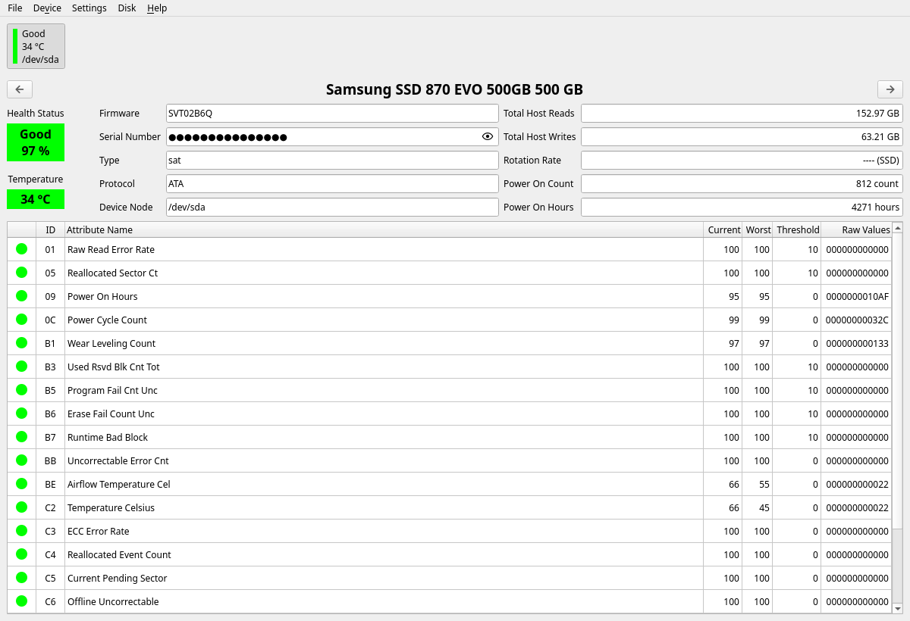
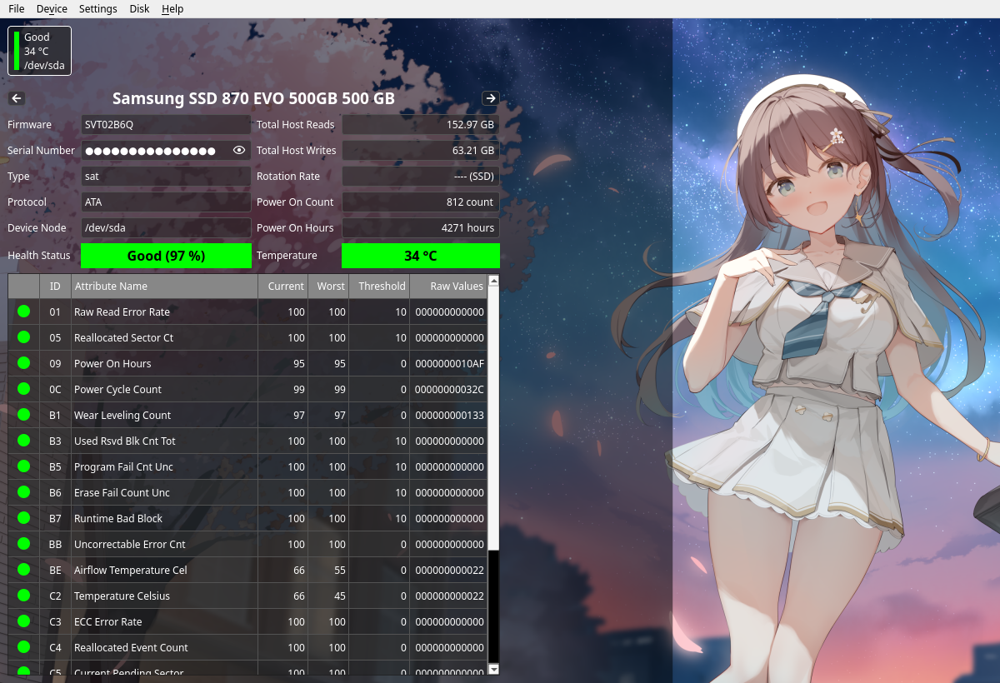

# DiskInfo

DiskInfo is a personal, unofficial fork of [QDiskInfo](https://github.com/edisionnano/QDiskInfo), a Qt frontend for `smartctl` (part of the smartmontools package) that shows the SMART (Self-Monitoring, Analysis, and Reporting Technology) data of modern hard disk drives. The application and its binary are still called QDiskInfo.

This repository is not affiliated with the upstream maintainer. All original work remains copyright its authors; see [Credits and License](#credits-and-license).

## Screenshots

| Default | CrystalDiskInfo theme |
|:---:|:---:|
|  |  |

The right-hand window uses the Aoi Night theme from CrystalDiskInfo, imported at runtime. Theme artwork remains the property of its authors.

## What this fork adds

- **Runtime CrystalDiskInfo themes.** Import a CDI ZIP and switch skins from `Settings > Theme` — no rebuild, and the selection is remembered across restarts.
- **Self-contained navigation and serial icons.** The disk arrows and the serial-number reveal button fall back to icons bundled with the app when the desktop icon theme cannot render them. A working desktop theme still takes priority, so Breeze, Adwaita and Papirus users see their native icons.
- **Runtime-only theming.** The old compile-time theme mode (`INCLUDE_OPTIONAL_RESOURCES` / `CHARACTER_IS_RIGHT`) has been removed.
- **Regression tests.** Theme parsing, ZIP import, icon fallbacks and the themed window are covered by CTest, and the suites run in GitHub Actions on every push.
- **No disk artwork in themed windows.** CDI `disk*` assets are multi-row disk-list strips rather than a single illustration, so the left status slot stays hidden and the disk selectors keep their default look.

See [CHANGELOG.md](CHANGELOG.md) for the detailed list of changes from upstream.

## Packaging and releases

This fork does not publish distribution packages, AppImages or Flatpak builds. Build it from source with the instructions below.

Packages and prebuilt binaries for upstream QDiskInfo are listed in the [upstream README](https://github.com/edisionnano/QDiskInfo#packages) and its [releases](https://github.com/edisionnano/QDiskInfo/releases/latest).

## Compiling and Installing

### Compilation and Runtime Dependencies

Debian and Debian-based distros (Ubuntu, Mint, Pop!_OS, etc.)
```sh
sudo apt install build-essential cmake git libgl1-mesa-dev libxkbcommon-dev libqt6svg6 qt6-base-dev qt6-tools-dev qt6-tools-dev-tools qt6-wayland smartmontools
```
Fedora and derivatives (Nobara Project, etc.)
```sh
sudo dnf install cmake git mesa-libGL-devel libxkbcommon-devel qt6-qtbase-devel qt6-qtsvg qt6-qttools-devel qt6-qtwayland-devel smartmontools
```
Arch Linux (includes Manjaro, EndeavourOS, CachyOS, Garuda Linux, etc.)
```sh
sudo pacman -Syu base-devel cmake git hicolor-icon-theme polkit qt6-base qt6-svg qt6-tools smartmontools
```

`qt6-svg` (`libqt6svg6` on Debian, `qt6-qtsvg` on Fedora) provides the SVG image plugin used by the bundled fallback icons.

### Compilation Steps
First you will need to clone the repository and cd inside
```sh
git clone https://github.com/Biologisten/DiskInfo.git && cd DiskInfo
```
Then you must create a build directory and cd inside, you can name it `build`
```sh
mkdir build && cd build
```
After that use CMake to set up the project. Qt version can also be set to 5 (for example for older distros); translations can also be disabled if you don't want to install the required tools package
```sh
cmake .. -DCMAKE_BUILD_TYPE:STRING=MinSizeRel -DQT_VERSION_MAJOR=6 -DENABLE_TRANSLATIONS=ON
```
Finally, compile the project with all the threads using
```sh
make -j$(nproc)
```
This will create a `QDiskInfo` binary in the build directory. You can install it with
```sh
sudo make install
```
If you installed QDiskInfo on your system using `sudo make install` and wish to uninstall it, run
```sh
sudo xargs rm < install_manifest.txt
```
in your build directory. The `install_manifest.txt` file is generated after running `sudo make install`, so if you no longer have it, install again and then uninstall.

### Running the Tests
Add `-DBUILD_TESTING=ON` to the CMake command above and build, then from the `build` directory run
```sh
ctest --output-on-failure
```
The icon fallback tests start the real window on Qt's offscreen platform (CTest sets `QT_QPA_PLATFORM=offscreen` for them) with a fake smartctl, so no display or devices are needed. Both suites also run in CI on every push, which additionally fails the build on newly introduced dead code and on virtual overrides that lack the `override` marker.

## Using CrystalDiskInfo Anime Themes
You can use the CrystalDiskInfo editions as runtime themes, without rebuilding QDiskInfo:<br>
1. Download the edition of CrystalDiskInfo you want (Aoi for example) in ZIP format from [here](https://crystalmark.info/en/download/).<br>
2. In QDiskInfo open `Settings > Theme > Import Themes from CDI ZIP...` and select the ZIP. Every theme in the archive is installed under `~/.local/share/qdiskinfo/themes` (`Open Themes Folder` from the same menu takes you there).<br>
3. Switch between the installed themes and `Default (No Theme)` at any time from the Theme menu; the selection is remembered across restarts.

Runtime themes are the only theming path; there is no compile-time theme build to configure. Theme artwork is not bundled or redistributed and remains the property of its authors.

## Localisation
Translations are inherited from upstream QDiskInfo and live in `translations/`. Upstream manages the [Crowdin project](https://crowdin.com/project/qdiskinfo); this fork simply carries the resulting `.ts` files.

To test a translation, build with `-DENABLE_TRANSLATIONS=ON` and force a locale, for example
```sh
LC_ALL=de_DE.UTF-8 ./QDiskInfo
```

## Credits and License

- Based on [QDiskInfo](https://github.com/edisionnano/QDiskInfo) by edisionnano and contributors. This is an unofficial fork and is not affiliated with the upstream maintainer.
- Licensed under the GNU General Public License v3.0; see [LICENSE](LICENSE). Changes in this fork are distributed under the same license.
- The application icon is a modified version of the KDE Partition Manager logo, available under GPL-3.0+.
- CrystalDiskInfo theme artwork is not bundled and remains the property of its authors.
